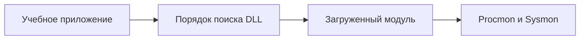

# Драйверы, DLL Hijacking и Side-Loading

## Схема

## Что сделал

- Исследовал драйверы Windows и загрузку DLL учебным приложением.
- Воспроизвёл DLL Hijacking и DLL Side-Loading на подготовленном стенде.
- Разобрал порядок поиска библиотек и файловые операции в Process Monitor.
