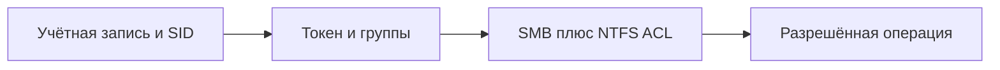

# Пользователи, группы и разрешения NTFS/SMB

## Схема

## Что сделал

- Создал локальных пользователей и группы, настроил разрешения NTFS и SMB.
- Проверил доступ под разными учётными записями.
- Разобрал RID Hijacking на отдельном снимке учебной ВМ и восстановил её состояние.
