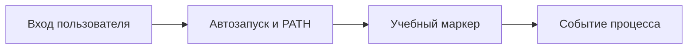

# Автозапуск и переменные среды

## Схема

## Что сделал

- Настроил учебные переменные среды и безопасный маркер автозапуска.
- Проверил влияние PATH и контекст запуска процесса.
- Удалил тестовые изменения после проверки.
