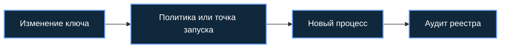

[Портфолио](../../../README.md) / [Windows](../README.md) / WIN-05

# WIN-05 · Реестр Windows и небезопасные настройки

> Разобрать безопасность конфигурации реестра и типовые точки закрепления.

| Формат | Исходный кейс | Основной фокус |
| :-- | :-- | :-- |
| Учебная практика PT Start | `842` | Windows |

## Стенд и схема

Windows/Windows Server с нужными ролями; для доменных команд — RSAT/модуль ActiveDirectory или GroupPolicy. Повышенная консоль нужна только для административных шагов.



Схема показывает логику лабораторной. Для точного повторения исходного кейса используются его адресный план, образы и версии компонентов. Подготовка среды описана в [руководстве по стендам](../../../docs/lab-environment.md).

## Ход работы

1. Сохранить снимок ВМ и экспортировать только изменяемые учебные ветки.
2. Исследовать Run, параметры установщика и Image File Execution Options.
3. Разобрать сценарии AlwaysInstallElevated, SpecialAccounts и IFEO на подготовленном образе.
4. Сопоставить изменение реестра с последующим запуском процесса и эффективными правами.
5. Восстановить исходные настройки и включённые средства защиты.

## Команды и контрольные проверки

```powershell
reg query HKCU\Software\Microsoft\Windows\CurrentVersion\Run
reg query HKLM\Software\Policies\Microsoft\Windows\Installer /v AlwaysInstallElevated
reg query HKCU\Software\Policies\Microsoft\Windows\Installer /v AlwaysInstallElevated
reg query "HKLM\SOFTWARE\Microsoft\Windows NT\CurrentVersion\Image File Execution Options"
```

Это команды проверки или пример исправления, а не сохранённый вывод с выполненного стенда. Полный набор действий зависит от подготовленного образа и версии ПО.

## Как подтвердить результат

- Сравнение точечных ключей до и после без личных данных.
- Связка изменения реестра и запуска; Sysmon 12/13/14 при включённых фильтрах.

Для фиксации фактического прогона используется [шаблон отчёта](../../../templates/run-report.md).

## Что важно для SOC

Скрытие пользователя в интерфейсе не удаляет учётную запись. Риск AlwaysInstallElevated связан с сочетанием машинной и пользовательской политик; ExecutionPolicy не является полноценной границей безопасности.

## Защита и повторная проверка

Не включать AlwaysInstallElevated, ограничить запись в чувствительные ветки, сохранять UAC и мониторинг PowerShell.

После изменения конфигурации повторяется исходная проверка: нужно подтвердить устранение причины и сохранение штатной функции, а не только исчезновение ошибки в интерфейсе.

<details>
<summary>Источник и границы разбора</summary>

Тема и порядок действий адаптированы из пользовательского архива **«пт.zip»**, файл `tasks/842_Guided_Case_3.5_-_Реестр.md`.
Это сжатый разбор учебной практики с добавленными схемой, критериями подтверждения и аналитическими пояснениями. Результаты чекеров и курсовые флаги не публикуются. Указания по официальной документации: [источники](../../../docs/sources.md).

</details>

---

[← Предыдущая](../04-startup-environment/README.md) · [Все лабораторные](../README.md) · [Следующая →](../06-nfs/README.md)
