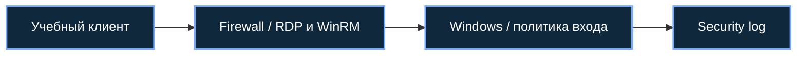

[Портфолио](../../../README.md) / [Windows](../README.md) / WIN-07

# WIN-07 · RDP, WinRM и блокировка учётных записей

> Настроить учебный удалённый доступ и проверить действие Account Lockout Policy.

| Формат | Исходный кейс | Основной фокус |
| :-- | :-- | :-- |
| Учебная практика PT Start | `853` | Windows |

## Стенд и схема

Windows/Windows Server с нужными ролями; для доменных команд — RSAT/модуль ActiveDirectory или GroupPolicy. Повышенная консоль нужна только для административных шагов.



Схема показывает логику лабораторной. Для точного повторения исходного кейса используются его адресный план, образы и версии компонентов. Подготовка среды описана в [руководстве по стендам](../../../docs/lab-environment.md).

## Ход работы

1. Настроить RDP и WinRM на учебной ВМ и отдельную учётную запись.
2. Проверить единичное штатное подключение и разрешения пользователя.
3. Воспроизвести ограниченную серию неверных входов до порога блокировки.
4. Сопоставить отказы, блокировку и успешный вход после восстановления доступа.
5. Вернуть строгую политику и ограничить удалённые подключения лабораторной подсетью.

## Команды и контрольные проверки

```powershell
Get-Service TermService,WinRM
Get-NetTCPConnection -State Listen | Where-Object LocalPort -in 3389,5985,5986
net accounts
Get-WinEvent -FilterHashtable @{LogName='Security';Id=4625,4740} -MaxEvents 20
```

Это команды проверки или пример исправления, а не сохранённый вывод с выполненного стенда. Полный набор действий зависит от подготовленного образа и версии ПО.

## Как подтвердить результат

- Настройки lockout, разрешённые источники и проверка подключения.
- События отказов и блокировки с временной линией.

Для фиксации фактического прогона используется [шаблон отчёта](../../../templates/run-report.md).

## Что важно для SOC

4625 показывает неудачный вход, 4740 — блокировку при включённом нужном аудите. Учитывать тип входа, домен и узел, где сформировано событие.

## Защита и повторная проверка

Использовать NLA/MFA там, где применимо, минимальные группы доступа и фильтрацию; не публиковать RDP и WinRM напрямую в интернет.

После изменения конфигурации повторяется исходная проверка: нужно подтвердить устранение причины и сохранение штатной функции, а не только исчезновение ошибки в интерфейсе.

<details>
<summary>Источник и границы разбора</summary>

Тема и порядок действий адаптированы из пользовательского архива **«пт.zip»**, файл `tasks/853_Guided_Case_3.7_-_Сетевой_стек.md`.
Это сжатый разбор учебной практики с добавленными схемой, критериями подтверждения и аналитическими пояснениями. Результаты чекеров и курсовые флаги не публикуются. Указания по официальной документации: [источники](../../../docs/sources.md).

</details>

---

[← Предыдущая](../06-nfs/README.md) · [Все лабораторные](../README.md) · [Следующая →](../08-local-policies/README.md)
