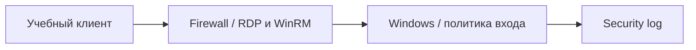

# RDP, WinRM и блокировка учётных записей

## Схема

## Что сделал

- Настроил учебный удалённый доступ через RDP и WinRM.
- Проверил Account Lockout Policy серией неверных входов.
- Разобрал события отказов и блокировки учётной записи и восстановил строгую политику.
