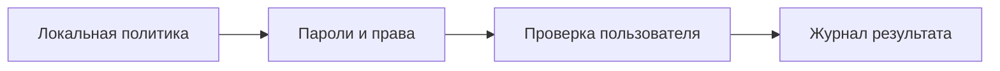

# Локальные политики безопасности

## Схема

## Что сделал

- Настроил локальные политики паролей, блокировки, аудита и прав пользователя.
- Проверил правила брандмауэра и доступ обычной учётной записи.
- Сохранил параметры применённой политики.
