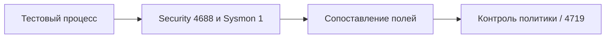

# Расширенный аудит и Sysmon

## Схема

## Что сделал

- Настроил расширенный аудит Windows и установил Sysmon с готовой конфигурацией.
- Сопоставил события создания процессов Security 4688 и Sysmon 1.
- Проверил изменение политики аудита по Event ID 4719 и восстановил настройки.
