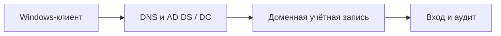

[Портфолио](../../../README.md) / [Windows](../README.md) / WIN-10

# WIN-10 · Контроллер домена Active Directory

> Развернуть учебный домен и проверить вход доменного пользователя с клиентской машины.

| Формат | Исходный кейс | Основной фокус |
| :-- | :-- | :-- |
| Учебная практика | `879` | Windows |

## Стенд и схема

Windows/Windows Server с нужными ролями; для доменных команд — RSAT/модуль ActiveDirectory или GroupPolicy. Повышенная консоль нужна только для административных шагов.



Схема показывает логику лабораторной. Для точного повторения исходного кейса используются его адресный план, образы и версии компонентов. Подготовка среды описана в [руководстве по стендам](../../../docs/lab-environment.md).

## Ход работы

1. Подготовить Windows Server и Windows-клиент в одной внутренней сети.
2. Назначить серверу постоянный IP, установить AD DS и создать учебный лес.
3. Направить DNS клиента на контроллер домена и проверить SRV-записи.
4. Ввести клиент в домен, создать пользователей и проверить вход.
5. Отличить локальную и доменную учётную запись, зафиксировать зависимость доменного входа от DNS.

## Команды и контрольные проверки

```powershell
Get-ADDomain
Get-ADDomainController -Filter *
Resolve-DnsName -Type SRV _ldap._tcp.dc._msdcs.lab.example.test
whoami /upn
# lab.example.test — пример; заменить на реальное имя учебного домена.
```

Это команды проверки или пример исправления, а не сохранённый вывод с выполненного стенда. Полный набор действий зависит от подготовленного образа и версии ПО.

## Как подтвердить результат

- Схема DC, DNS и клиента; домен и IP-план.
- Подтверждение членства в домене и входа без паролей в отчёте.

Для фиксации фактического прогона используется [шаблон отчёта](../../../templates/run-report.md).

## Что важно для SOC

Проверять DNS, время и доступность контроллера до выводов об ошибке пароля. Ошибка доменного входа может быть инфраструктурной.

## Защита и повторная проверка

Разделять административные и пользовательские учётные записи, ограничивать доступ к DC и включать аудит изменений каталога.

После изменения конфигурации повторяется исходная проверка: нужно подтвердить устранение причины и сохранение штатной функции, а не только исчезновение ошибки в интерфейсе.

<details>
<summary>Источник и границы разбора</summary>

Тема и порядок действий адаптированы из пользовательского архива **«пт.zip»**, файл `tasks/879_Guided_Case_3.10_-_DC.md`.
Это сжатый разбор учебной практики с добавленными схемой, критериями подтверждения и аналитическими пояснениями. Результаты чекеров и курсовые флаги не публикуются. Указания по официальной документации: [источники](../../../docs/sources.md).

</details>

---

[← Предыдущая](../09-audit-sysmon/README.md) · [Все лабораторные](../README.md) · [Следующая →](../11-iis/README.md)
