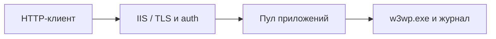

# IIS, аутентификация и контекст пула

## Схема

## Что сделал

- Развернул IIS, настроил учебный сайт, аутентификацию и TLS-сертификат.
- Проверил контекст пула приложений и разобрал сценарий SeImpersonatePrivilege.
- Проверил права и настройки после изменений.
