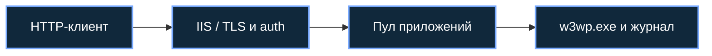

[Портфолио](../../../README.md) / [Windows](../README.md) / WIN-11

# WIN-11 · IIS, аутентификация и контекст пула

> Настроить учебный сайт и проверить риск избыточных привилегий рабочего процесса IIS.

| Формат | Исходный кейс | Основной фокус |
| :-- | :-- | :-- |
| Учебная практика PT Start | `880` | Windows |

## Стенд и схема

Windows/Windows Server с нужными ролями; для доменных команд — RSAT/модуль ActiveDirectory или GroupPolicy. Повышенная консоль нужна только для административных шагов.



Схема показывает логику лабораторной. Для точного повторения исходного кейса используются его адресный план, образы и версии компонентов. Подготовка среды описана в [руководстве по стендам](../../../docs/lab-environment.md).

## Ход работы

1. Установить роль IIS и создать отдельный сайт и пул приложений.
2. Настроить привязку, выбранный способ аутентификации и учебный TLS-сертификат.
3. Проверить HTTP/HTTPS и доступ под нужной учётной записью.
4. На подготовленном стенде разобрать сценарий SeImpersonatePrivilege из кейса, зафиксировать контекст процесса.
5. Уменьшить поверхность атаки, проверить права пула и повторить проверки.

## Команды и контрольные проверки

```powershell
Import-Module WebAdministration
Get-Website
Get-WebBinding
Get-ChildItem IIS:\AppPools
# whoami /priv имеет смысл именно в исследуемом контексте, не в произвольной консоли администратора.
```

Это команды проверки или пример исправления, а не сохранённый вывод с выполненного стенда. Полный набор действий зависит от подготовленного образа и версии ПО.

## Как подтвердить результат

- Настройки сайта, bindings и identity пула.
- TLS-проверка и сопоставление IIS access log с процессом w3wp.exe.

Для фиксации фактического прогона используется [шаблон отчёта](../../../templates/run-report.md).

## Что важно для SOC

Наличие SeImpersonatePrivilege само по себе не подтверждает эксплуатацию. Нужны условия сценария, токен и цепочка создания процессов.

## Защита и повторная проверка

Использовать отдельные пулы и минимальные права, обновлять ОС, ограничивать доступ сайта к системным ресурсам.

После изменения конфигурации повторяется исходная проверка: нужно подтвердить устранение причины и сохранение штатной функции, а не только исчезновение ошибки в интерфейсе.

<details>
<summary>Источник и границы разбора</summary>

Тема и порядок действий адаптированы из пользовательского архива **«пт.zip»**, файл `tasks/880_Guided_Case_3.11_-_IIS.md`.
Это сжатый разбор учебной практики с добавленными схемой, критериями подтверждения и аналитическими пояснениями. Результаты чекеров и курсовые флаги не публикуются. Указания по официальной документации: [источники](../../../docs/sources.md).

</details>

---

[← Предыдущая](../10-active-directory/README.md) · [Все лабораторные](../README.md) · [Следующая →](../12-ad-cs/README.md)
