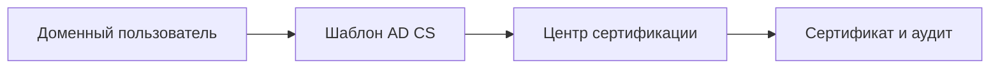

# AD CS и риск ESC1

## Схема

## Что сделал

- Развернул AD CS и настроил учебный шаблон сертификата для подписи кода.
- Разобрал сценарий ESC1 и параметры Enroll, SAN, EKU и одобрения выпуска.
- Исправил небезопасные настройки шаблона и повторил проверку.
