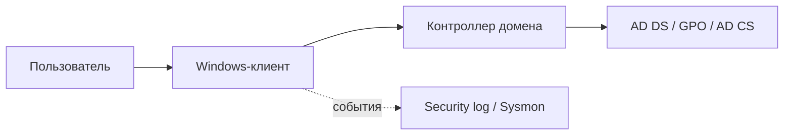

[← На главную](../../README.md)

# Windows и доменная инфраструктура

Права, службы, аудит, Active Directory и границы доверия. В разделе **13 лабораторных** из учебного архива.

| Лабораторная | Тема | ID исходного кейса |
| :-- | :-- | :-- |
| [WIN-01](01-services/README.md) | [Службы Windows и Unquoted Service Path](01-services/README.md) | `834` |
| [WIN-02](02-drivers-dll/README.md) | [Драйверы, DLL Hijacking и Side-Loading](02-drivers-dll/README.md) | `836` |
| [WIN-03](03-users-permissions/README.md) | [Пользователи, группы и разрешения NTFS/SMB](03-users-permissions/README.md) | `838` |
| [WIN-04](04-startup-environment/README.md) | [Автозапуск и переменные среды](04-startup-environment/README.md) | `840` |
| [WIN-05](05-registry/README.md) | [Реестр Windows и небезопасные настройки](05-registry/README.md) | `842` |
| [WIN-06](06-nfs/README.md) | [NFS между Linux и Windows](06-nfs/README.md) | `852` |
| [WIN-07](07-rdp-winrm/README.md) | [RDP, WinRM и блокировка учётных записей](07-rdp-winrm/README.md) | `853` |
| [WIN-08](08-local-policies/README.md) | [Локальные политики безопасности](08-local-policies/README.md) | `855` |
| [WIN-09](09-audit-sysmon/README.md) | [Расширенный аудит и Sysmon](09-audit-sysmon/README.md) | `860` |
| [WIN-10](10-active-directory/README.md) | [Контроллер домена Active Directory](10-active-directory/README.md) | `879` |
| [WIN-11](11-iis/README.md) | [IIS, аутентификация и контекст пула](11-iis/README.md) | `880` |
| [WIN-12](12-ad-cs/README.md) | [AD CS и риск ESC1](12-ad-cs/README.md) | `881` |
| [WIN-13](13-gpo/README.md) | [Групповые политики и доверие к SYSVOL](13-gpo/README.md) | `883` |
